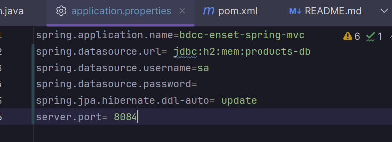
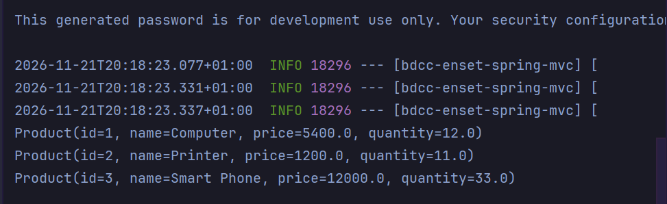
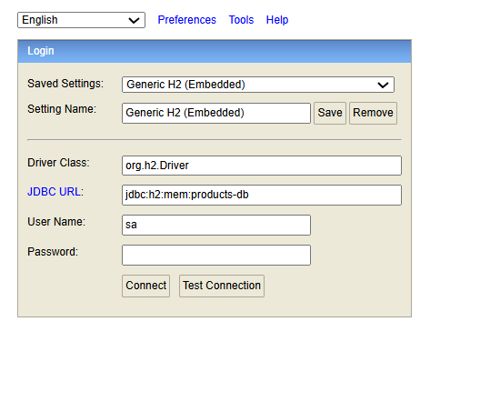
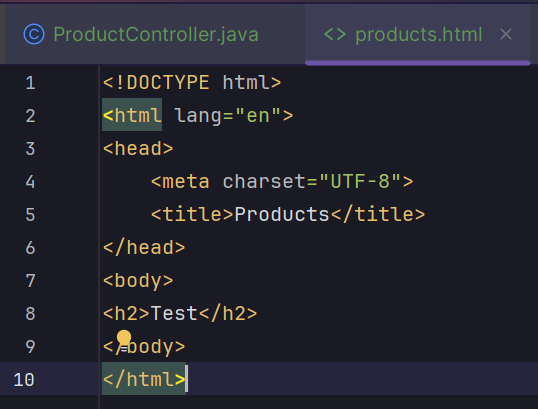

# Activit-Pratique-N-3--Spring-MVC-Thymeleaf
1. création de la classe produit

2. création des différents produit dans la base de données

3. Configuration de application.properties pour test

4. Test de la console

5. test port 8084 sur la console localhost

6. création du ProductController et de la page html qui la gère

7. résultat de la page product.html après ajout de la dépendance webjars

8. 