# Activit-Pratique-N-3--Spring-MVC-Thymeleaf
1. création de la classe produit
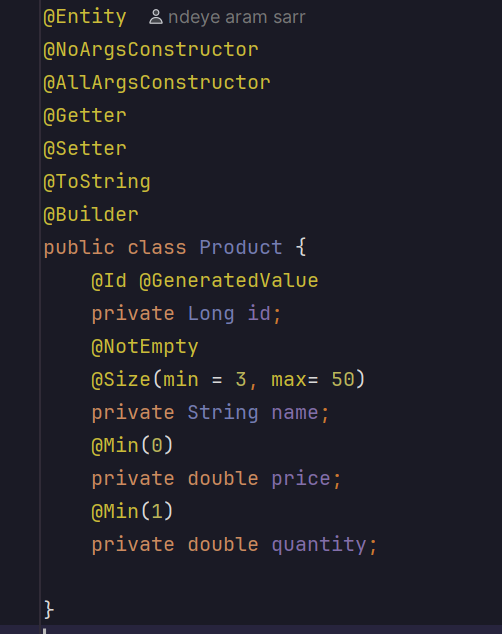
2. création des différents produit dans la base de données
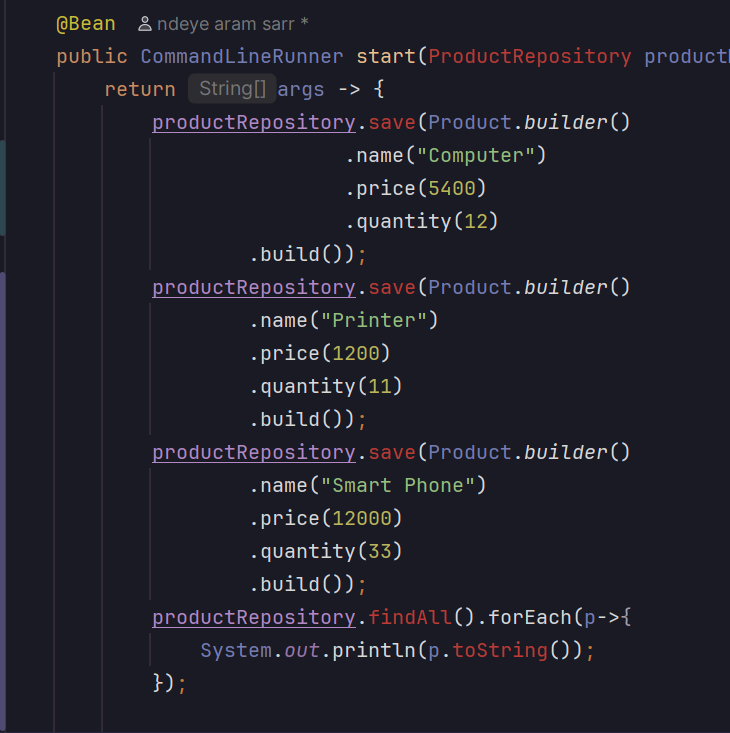
3. Configuration de application.properties pour test

4. Test de la console

5. test port 8084 sur la console localhost

6. création du ProductController et de la page html qui la gère

7. résultat de la page product.html après ajout de la dépendance webjars et ajout du bouton supprimer
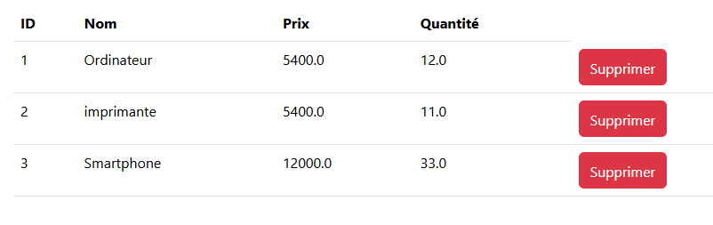
8. ajout d'une méthode de suppression par id ainsi que d'une redirection après suppression 
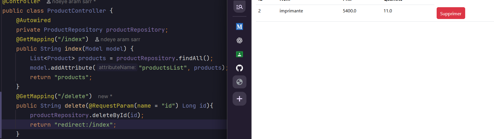
9. ajout d'un bouton de confirmation de supression 
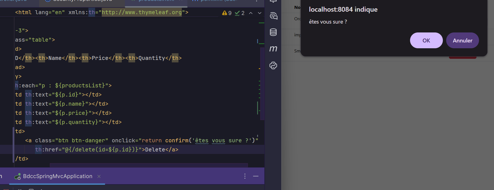
10. ajout d'une barre de nagivation 
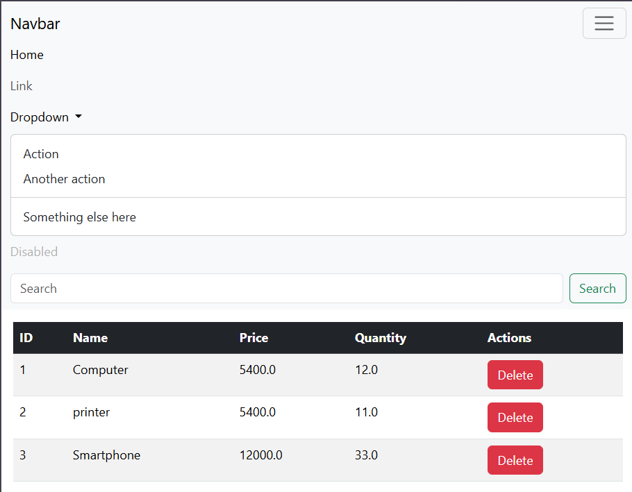
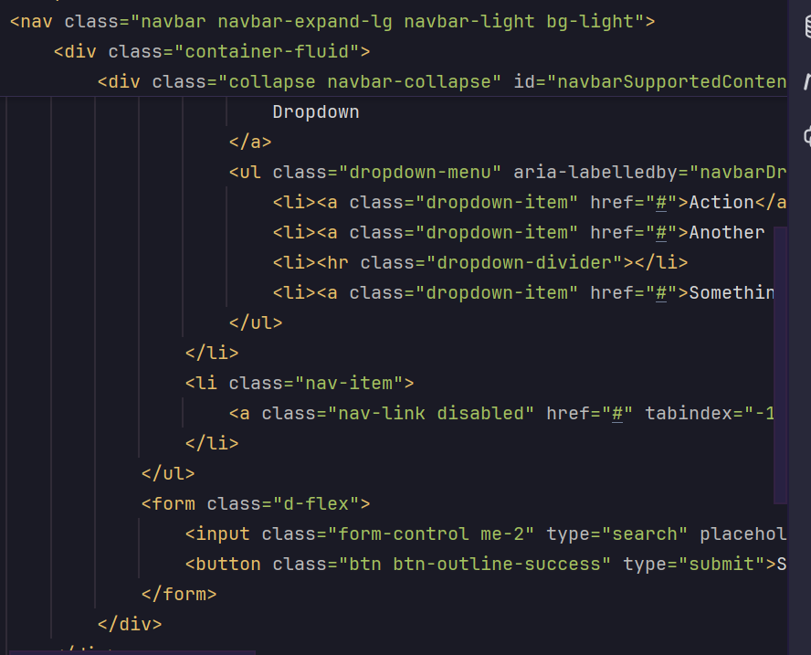
11. gestion de la navigation : redirection de home vers index 

12. Ajout d'un bouton new product 
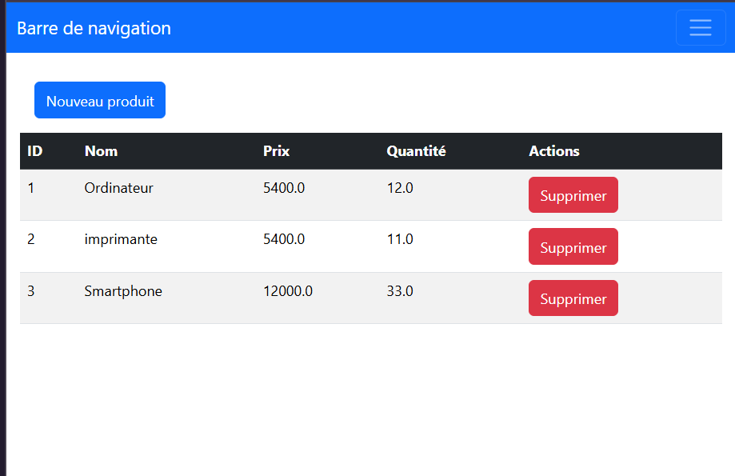

13. Ajout de la page new product 
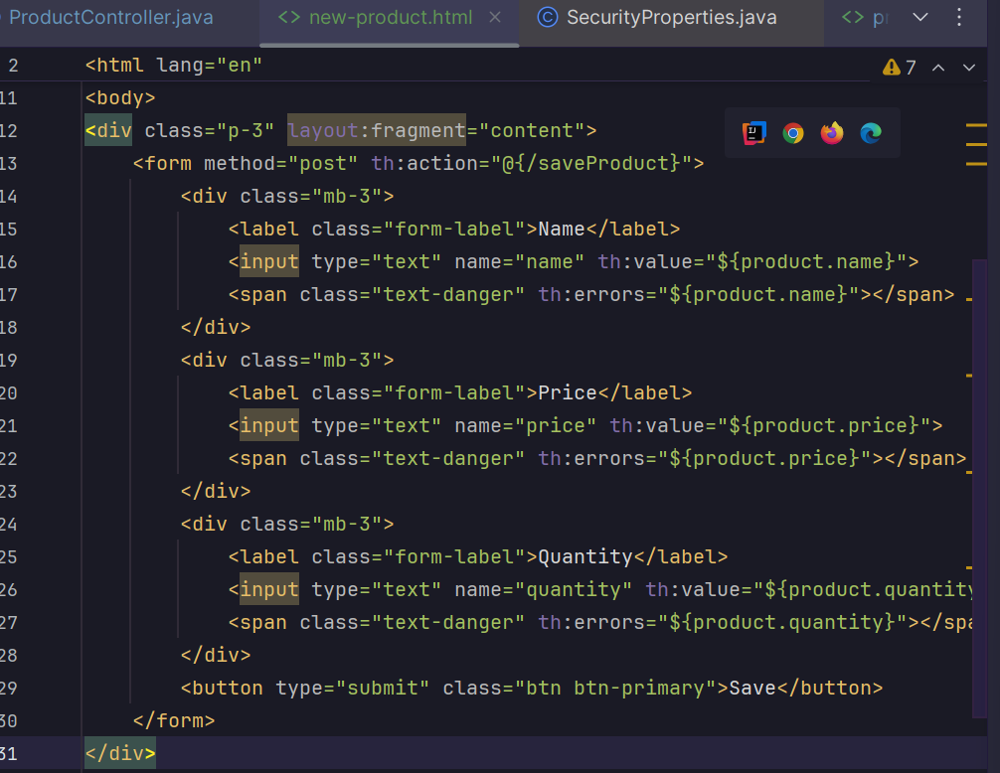
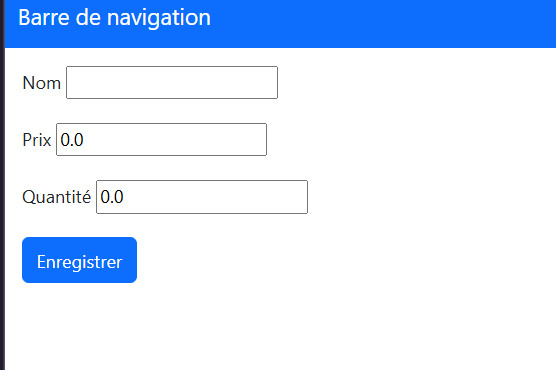
14. respect des conditions du formulaire et ajout d'un nouveau produit
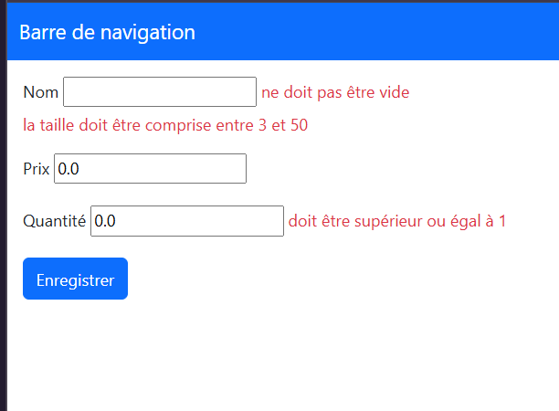
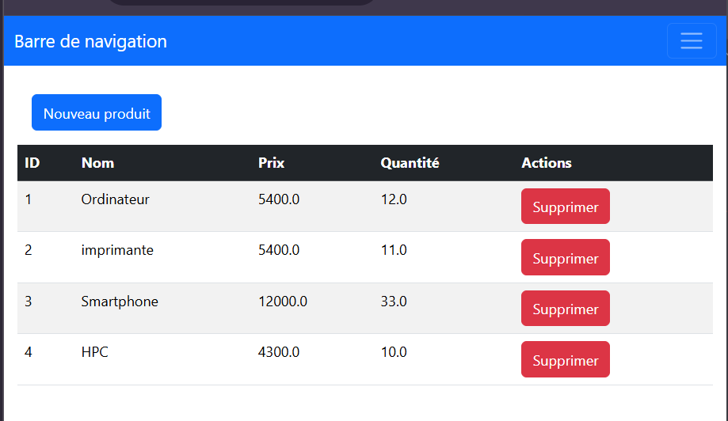